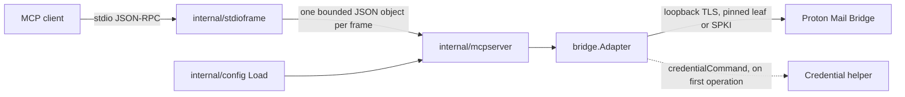

# Architecture

Croton is one stdio Model Context Protocol (MCP) executable over a Proton Mail
Bridge adapter, a secure configuration opener, a strict JSON decoder, and one
bounded stdio frame limiter. This page is the map: the process shape with its trust
chain, every package with its role and what it must never do, where each
statement of the product vision is realized in the tree, and what deliberately
lives outside the module.

Tool contracts live in [docs/MCP.md](MCP.md); trust boundaries and residual risks live in
[docs/THREAT_MODEL.md](THREAT_MODEL.md); deployment steps live in
[docs/DEPLOYMENT.md](DEPLOYMENT.md). This page does not restate them.

## Product form

- A local stdio MCP server, usable by any standards-compatible MCP client.
- A Go implementation with a reusable, MCP-neutral Proton Mail Bridge adapter.
- An independent, unofficial community project, not affiliated with or
  endorsed by Proton AG.
- A public, installable open-source product. Account material and personal
  automation stay outside the module.

## Processes

The process is one chain from an MCP client to Proton Mail Bridge. It enters
through the bounded frame reader in `internal/stdioframe`.

### `croton-mcp` (Mail)

`cmd/croton-mcp` loads one Mail configuration through `internal/config`,
constructs the six-tool server in `internal/mcpserver`, and serves it over
stdio. The server owns the MCP catalog; `bridge.Adapter` owns exactly one
authenticated IMAP session and does not dial the Bridge or run the
credential command until the first operation. The connection is loopback-only
over TLS with explicit trust material; certificate-authority bundles are
rejected. The six tools are listed in [docs/MCP.md](MCP.md#tools).

Mail triage is specified in [docs/MCP.md](MCP.md#triage-tools): five default-off tools behind
the local `mutations.enabled` file opt-in, limited to Seen `UID STORE` and
native `UID MOVE`. All five are implemented. When the
opt-in is absent or false, the default, the catalog is the six read tools and
the adapter sends no write. When it is true, `cmd/croton-mcp` also registers
`mark_read` and `mark_unread`, whose only write is `bridge.Adapter.SetSeen`:
one Seen-only `UID STORE` per UID on the same session, after a read-write
SELECT confirms the source UIDVALIDITY. It also registers `move_mail`, whose
only write is `bridge.Adapter.Move`: one native `UID MOVE` per UID after the
same SELECT and a fresh `LIST` on that session validates the destination.
`archive_mail` and `trash_mail` use the same path through
`bridge.Adapter.Archive` and `bridge.Adapter.Trash`, mapping the destination
from the one listed mailbox carrying `\Archive` or `\Trash`.

## Packages

Every directory holding tracked Go source, its role, and the line it must
never cross. The role column follows the package doc comments.

| Package | Role | Must never |
| --- | --- | --- |
| `bridge` | Bounded, MCP-neutral connection boundary and mail normalization primitives for Proton Mail Bridge; `Adapter` serializes one authenticated IMAP session that is read-only except for the opt-in Seen `SetSeen` and native `Move`, `Archive` and `Trash`. | Import MCP types, add a mutating IMAP operation outside the planned Seen `UID STORE` and native `UID MOVE` allowlist of design 0005, or connect anywhere but loopback over TLS. |
| `cmd/croton-mcp` | The Mail stdio executable: loads one Mail configuration and serves the six read-only mail tools, plus the Seen, move, archive and trash triage tools when `mutations.enabled` is true. | Write anything but protocol to stdout. |
| `internal/config` | Secure configuration opener for the Mail schema; one descriptor-relative, no-follow `load` path that `Load` uses. | Offer a path-based fallback open, follow a symlink, or accept a file readable by group or world. |
| `internal/mcpserver` | Croton's Mail MCP server: the six-tool read catalog, the opt-in Seen, move, archive and trash triage tools, bounded argument decoding, and the stdio transport. | Register a mutating tool outside the planned default-off triage catalog of design 0005, expose attachment bytes, or add Roots, Sampling, or MCP Logging. |
| `internal/stdioframe` | The bounded newline-delimited stdio transport used by the Croton executable: each inbound frame is proven to be one strictly decoded JSON object within the 64 KiB ceiling before the SDK sees it. | Pass an oversize or ambiguous frame to the SDK, close standard output, or write anything but JSON-RPC to it. |
| `internal/strictjson` | Bounded, unambiguous JSON decoding used by the server. | Accept duplicate keys, trailing values, or unbounded input. |
| `internal/testkit` | Deterministic IMAP fixtures: a synthetic loopback IMAP server. | Contain live account material, or be imported by non-test code. |

## Vision to tree

Each product-form statement and where it is realized. "Reserved" means the
boundary exists in the tree but nothing ships behind it, with no date.

| Statement | Where |
| --- | --- |
| Local `stdio` MCP server usable by standards-compatible clients | `cmd/croton-mcp` over the `internal/stdioframe` transport; stdout is protocol-only, diagnostics go to stderr; client-neutral contract exercised in CI against synthetic fixtures. |
| Go implementation with a reusable, `MCP-neutral` Mail Bridge adapter | `bridge` imports no MCP types; `internal/mcpserver` is its only in-tree consumer. |
| Independent, `unofficial` community project | README's non-affiliation statement; no Proton logos or branding in the tree. |
| Public, installable open-source product with `account material` and personal automation kept outside | Apache 2.0 `LICENSE`; `SECURITY.md` sensitive-data rules; only synthetic `.test` fixtures in `internal/testkit`; see "Outside the module". Reserved: additional Proton services. The Mail triage writes of design 0005 are implemented behind the default-off `mutations.enabled` opt-in. |

## Outside the module

These deliberately live elsewhere and have no path in this tree:

- Digest scheduling and delivery. `select_digest_candidates` selects metadata;
  composing, timing, and sending a digest is personal automation.
- Calendar and every Proton service other than Mail.
- Account material: Proton credentials, account identifiers, mailbox
  contents, Bridge certificates, and unredacted protocol logs.
- Factory tooling: the credential helper, Proton Mail
  Bridge, secret enrollment, and the deployment host described in
  [docs/DEPLOYMENT.md](DEPLOYMENT.md).
